# How the code is laid out

One rule shapes everything: **the model never writes a timestamp.** It points at line ids, and code turns them into cut points. Everything else is about making those picks good and making the run survive bad inputs and bad models.

## Flow

```mermaid
flowchart LR
    A[scripts] --> B[parse]
    B --> C[names]
    C --> D[rules: score every line]
    D --> E[tag: model names best hook and cliffhanger lines]
    E --> F[candidates: build and snap clips]
    F --> G[judge: cold viewer scores the best ~140]
    G --> H[jury: second model checks the shortlist]
    H --> I[rank: varied list, craft checks, control pick]
    I --> J[order: pairwise for the top 12]
    J --> K[export: promos, edit list, cut scripts]
```

In `--offline` mode the model steps (tag, judge, jury, order) are skipped. If a model step fails mid-run, the pipeline logs it, keeps the rule result for that step, and lists it under `degraded` in `run_meta.json`.

## Modules

| Area | File | What it does |
|---|---|---|
| Input | `parse.py` | Reads scripts in several formats and encodings; splits a whole series in one file into episodes |
| | `doctor.py` | `check` command: what got parsed, warnings about odd times or missing lines, and a quick model test |
| | `names.py`, `bible.py` | Clean up speaker labels that drift; one model call builds a cast list |
| Picking | `rules.py` | Genre-neutral word lists and line scores for hooks, cliffhangers and ad risk |
| | `tag.py` | One model call per episode returns the best hook and cliffhanger line ids |
| | `candidates.py`, `features.py` | Build clips from hook to cliffhanger, snap cuts to shots, measure each clip |
| | `rank.py` | Hard limits, craft checks, scoring, the varied final list, and the "post first" pick |
| Judging | `render.py` | What a clip looks like to a judge (a timed transcript) |
| | `verdicts.py` | The judge's answer format, tolerant of odd replies, plus merging two passes |
| | `store.py` | Saves each clip's verdict, so a clip is judged once and keeps its score |
| | `judge.py` | Batches clips for the cold-viewer judge, two passes, refines strong cuts |
| | `jury.py` | Second model from a different family; can veto clips |
| | `order.py` | Pairwise comparisons for the final order |
| Models | `providers.py` | Provider list, API keys, error types (bad key, no credit, unknown model, refusal) |
| | `llm.py` | The client: caching, key rotation, retries, falling back on unsupported settings |
| Running | `config.py`, `profiles.py` | Settings, and the fast / standard / full presets |
| | `pipeline.py` | Runs the steps in order, with progress and fallbacks |
| | `export.py` | Writes promos (md, csv, json), the edit list, and bash and PowerShell cut scripts |
| Checking | `evaluate.py`, `baseline.py`, `audit.py`, `learn.py` | Validity checks, the model-writes-timestamps baseline, blind audits by other models |
| Interface | `__main__.py`, `../app.py` | Command line and the Streamlit review app |

## Choices worth knowing

- **Everything is cached.** Every model answer is saved under `.cache/`, so rerunning after a crash or a settings change only pays for what's new.
- **Verdicts are stored per clip,** not per batch. Before this, the same clip could score differently depending on which clips it was judged with, and small changes reshuffled the final list.
- **Errors are typed.** A bad key or a missing model stops calls to that provider at once instead of retrying, while rate limits and timeouts back off and retry a few times.
- **Model replies are read leniently.** `"b16"`, `"4/5"` and `"five"` are all accepted, since different models answer in different shapes.
- **Profiles trade time for checking.** `fast` turns off the model's reasoning for tagging and judges once; `full` adds a second pass, refinement, the second judge and pairwise ordering.

## Tests

`python -m pytest -q` runs without a key or network. It covers parsing in many formats (three made-up shows plus broken files), cut validity, fake models that fail in realistic ways, fallbacks, profiles, and the per-clip verdict store.
